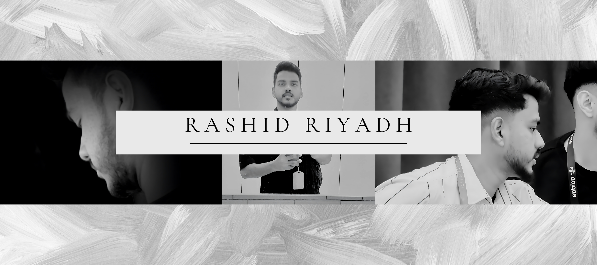

<p align="center">
  
</p>

<div align="center">

<!-- Animated "Running Name" Typing SVG -->
<a href="https://github.com/rashidriyadh714-dev">
  
</a>

<h1 align="center">Hi, I'm Rashid Riyadh 👋</h1>

<p align="center">
  <b>AI Researcher &bull; Deep Learning &bull; Autonomous Agentic Systems</b><br>
  <i>Specializing in Multimodal AI, Computer Vision (CORE A Published), and Production Software</i>
</p>

<!-- Top Credibility & Social Badges -->
<p align="center">
  <a href="https://bmvc2026.bmva.org/programme/accepted_papers/">
    
  </a>
  <a href="https://arxiv.org/abs/2608.23923">
    
  </a>
  <a href="https://www.linkedin.com/in/rashid-riyadh/">
    
  </a>
  <a href="https://huggingface.co/mohrashid">
    
  </a>
  <a href="https://www.kaggle.com/mohammedrashid714">
    
  </a>
</p>

</div>

---

### 💻 System Terminal

```bash
$ neofetch --profile rashid-riyadh
---------------------------------
OS        : Linux / macOS / Cloud Edge
Focus     : Multimodal Deep Learning, Computer Vision & Agentic AI
Research  : BMVC 2026 Accepted Author (CORE A) | arXiv:2608.23923
Systems   : ActionLayer (Shipaton '26) | Truth-Ledger | UniNexus AI
Stack     : PyTorch, CUDA, SegFormer, SAHI, Python, Docker, React, Power BI
Motto     : "Build solutions that matter. Make software verifiable, intelligent, and robust."
```

---

### 📊 Research & Key Highlights

<div align="center">

| 🏆 Top Milestone | 🔬 Focus Area | 🚀 Flagship Project | 💡 Venture |
| :---: | :---: | :---: | :---: |
| **BMVC 2026 Accepted**<br><sub>Main Conference (#715)</sub> | **Multimodal AI & Vision**<br><sub>PyTorch, RoBERTa, SegFormer</sub> | **ActionLayer**<br><sub>Shipaton '26 Lead Developer</sub> | **Cradle Fund Malaysia**<br><sub>Selected Startup Pitch</sub> |

</div>

---

## ⚡ Executive Summary

I am an **AI Researcher and Software Engineer** focused on **multimodal deep learning**, **computer vision**, and **verifiable agentic architectures**:

- 🔬 **Peer-Reviewed Research:** Author of an accepted main-conference paper at **BMVC 2026 (CORE A)** and preprints on **arXiv** focusing on efficient content-adaptive inference (SAHI) and semantic segmentation (SegFormer-B2).
- 🚀 **Applied Systems Engineering:** Lead Developer of **ActionLayer** (submitted for the *Shipaton 2026 Next Gen Award*) and selected to pitch an early-stage multilingual AI communication system to **Cradle Fund Malaysia**.
- 🏆 **Competitions & Awards:** National Finalist in the **Huawei ICT Competition 2025**; 3rd Place at **FusionX Hackathon**; recipient of the **Dean's List Award**.

---

## 🔬 Publications & Research

<table width="100%">
  <tr>
    <td width="72%">
      <b>MEIA: Reliability-Aware Multimodal Learning for Joint Emotion, Intention, and Action Recognition</b><br>
      <i>British Machine Vision Conference (BMVC 2026) &bull; Main Conference (#715)</i><br>
      <small>Engineered a multimodal deep learning framework jointly modeling visual backbones, contextual RoBERTa textual representations, and behavioral cues with automated validation to guarantee experimental reproducibility.</small><br>
      <code>PyTorch</code> <code>CUDA 12.6</code> <code>Multimodal Fusion</code> <code>RoBERTa</code>
    </td>
    <td width="28%" align="center">
      <a href="https://bmvc2026.bmva.org/programme/accepted_papers/">
        
      </a><br/><br/>
      <a href="https://github.com/rashidriyadh714-dev/MEIA-Framework">
        
      </a>
    </td>
  </tr>
  <tr>
    <td width="72%">
      <b>ROI-Gated SAHI: Content-Adaptive Slicing-Based Inference for Efficient Object Detection</b><br>
      <i>Submitted to IEEE Open Journal of the Computer Society (OJ-CS) &bull; Under Review</i><br>
      <small>Content-adaptive slicing algorithm reducing redundant slice computation during small object detection on ultra high-resolution aerial and ground imagery.</small><br>
      <code>Computer Vision</code> <code>SAHI</code> <code>Object Detection</code> <code>Edge Inference</code>
    </td>
    <td width="28%" align="center">
      <a href="https://arxiv.org/abs/2608.23923">
        
      </a>
    </td>
  </tr>
  <tr>
    <td width="72%">
      <b>Transformer-Based Semantic Segmentation for Road Surface Damage Detection</b><br>
      <i>Future Cities Conference (FCC 2026) &bull; Accepted & Presented</i><br>
      <small>Fine-tuned SegFormer-B2 pipeline across 4,300+ image-mask pairs achieving high-accuracy automated road distress segmentation.</small><br>
      <code>SegFormer-B2</code> <code>Semantic Segmentation</code> <code>Deep Learning</code>
    </td>
    <td width="28%" align="center">
      <a href="https://lnkd.in/p/geDwqCZk">
        
      </a>
    </td>
  </tr>
</table>

---

## 🌟 Featured Projects

### 1. [ActionLayer — Source-Grounded Agentic Workflow Compiler](https://github.com/rashidriyadh714-dev/Hackathon_Competeion)
> **Shipaton 2026 Next Gen Award Submission** &bull; *Lead Developer*
- Transforms unstructured competition briefs, hackathon rules, and grant call PDFs into deterministic **Directed Acyclic Graphs (DAGs)**.
- Integrates strict source grounding and human-in-the-loop validation checkpoints to eliminate deadline and requirement hallucinations.
- Structured as a containerized monorepo using **Docker Compose** and **pnpm workspaces**.
- **Tech Stack:** TypeScript, React, Docker, pnpm, REST APIs
- 🔗 **Repository:** [Hackathon_Competeion](https://github.com/rashidriyadh714-dev/Hackathon_Competeion)

---

### 2. [MEIA-Framework — Multimodal Deep Learning Platform](https://github.com/rashidriyadh714-dev/MEIA-Framework)
> **Official Codebase for Accepted BMVC 2026 Paper (#715)**
- Open-source PyTorch implementation jointly modeling visual embeddings, contextual RoBERTa textual representations, and behavioral cues.
- Features custom multi-task loss functions, cross-split data leakage verification, and quantitative ablation testing suites.
- **Tech Stack:** Python, PyTorch, CUDA 12.6, RoBERTa, Hugging Face, Computer Vision
- 🔗 **Repository:** [MEIA-Framework](https://github.com/rashidriyadh714-dev/MEIA-Framework)

---

### 3. [Truth-Ledger — Misinformation Detection System](https://github.com/rashidriyadh714-dev/Fact-check-application-for-competition)
> **Full-Stack Fact-Checking & Fake News Verification Web App**
- Hybrid verification engine combining rule-based heuristics with local and hosted transformer models.
- Features per-item verification management, full REST API endpoints, and a responsive mobile-first interface.
- **Tech Stack:** React 18, TypeScript, Tailwind CSS, Express.js, Drizzle ORM, Docker
- 🔗 **Links:** [🌐 Live Demo](https://fact-check-fgi6.onrender.com/) &bull; [📂 Code Repository](https://github.com/rashidriyadh714-dev/Fact-check-application-for-competition)

---

### 4. [Foodpanda Operations & Business Intelligence Suite](https://github.com/rashidriyadh714-dev/Data-Driven-Decision-Making-with-Power-BI-Foodpanda-Analysis-Dataset-2025-)
> **Commercial Analytics & KPI Modeling Dashboard**
- Interactive 3-page business intelligence dashboard modeling 6,000+ real-world commercial delivery records.
- Implemented 30+ custom DAX measures for churn probability, revenue forecasts, and fleet delivery times.
- **Tech Stack:** Power BI, Power Query, DAX, Data Modeling
- 🔗 **Links:** [📊 LinkedIn Showcase](https://lnkd.in/p/gbCqcifz) &bull; [📂 Code Repository](https://github.com/rashidriyadh714-dev/Data-Driven-Decision-Making-with-Power-BI-Foodpanda-Analysis-Dataset-2025-)

---

### 5. [Diabetes Risk Predictor with Explainable AI](https://github.com/rashidriyadh714-dev/diabetes-prediction-xgboost)
> **End-to-End Clinical Risk Assessment Web App**
- Machine learning pipeline utilizing XGBoost, achieving **85% accuracy** and **0.85 ROC-AUC** on clinical data.
- Incorporates **SHAP** feature importance explainability and a bilingual English-Malay Streamlit interface.
- **Tech Stack:** Python, Scikit-learn, XGBoost, Pandas, Streamlit, SHAP
- 🔗 **Links:** [🚀 Live App](https://rashid-diabetes-prediction-xgboost.streamlit.app/) &bull; [📂 Code Repository](https://github.com/rashidriyadh714-dev/diabetes-prediction-xgboost)

---

## 🛠 Tech Stack

### Languages & Core
<p>
  
  
  
  
  
  
</p>

### AI, Machine Learning & Computer Vision
<p>
  
  
  
  
  
  
  
  
</p>

### Frameworks, Tools & Platforms
<p>
  
  
  
  
  
  
  
  
</p>

---

## 🏆 Honors & Recognitions

- 🥇 **Accepted Paper Author** &bull; *British Machine Vision Conference (BMVC 2026)* — CORE A International Conference.
- 💡 **Idea Pitch Selected** &bull; *Cradle Fund Malaysia* — Multilingual AI prototype ([Pitch](https://lnkd.in/p/gQNvXDAg) &bull; [Demo](https://lnkd.in/p/ghVBiT9R)).
- 🇲🇾 **National Finalist** &bull; *Huawei ICT Competition 2025 (Malaysia)*.
- 🥉 **3rd Place Winner** &bull; *CityU FusionX Hackathon*.
- 🎖️ **Dean's List Recognition**.

---

## 📬 Let's Connect

- **LinkedIn:** [linkedin.com/in/rashid-riyadh](https://www.linkedin.com/in/rashid-riyadh/)
- **GitHub:** [github.com/rashidriyadh714-dev](https://github.com/rashidriyadh714-dev)
- **Hugging Face:** [huggingface.co/mohrashid](https://huggingface.co/mohrashid)
- **Kaggle:** [kaggle.com/mohammedrashid714](https://www.kaggle.com/mohammedrashid714)
- **Email:** [rashidriyadh714@gmail.com](mailto:rashidriyadh714@gmail.com)

---

<p align="center">
  <i>"Build solutions that matter. Make software verifiable, intelligent, and robust."</i>
</p>
